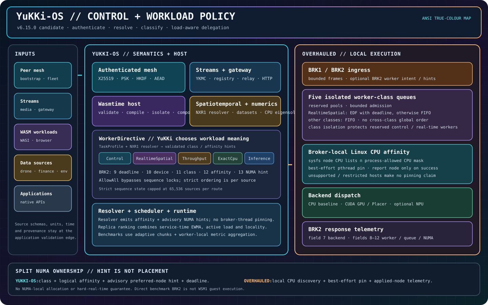

# YuKKi-OS v6.17.0

> **Coordinate the system. Connect the workload. Keep execution flexible.**
>
> A distributed control plane for peers, streams, and sandboxed workloads—with accelerator execution delegated to interoperable backends.

> **Release status:** v6.17.0 was published on 2026-11-22 from the merged release commit. GitHub Release assets include native Linux/macOS binaries, browser-WASM and WASI artifacts, and SHA-256 checksums.

**YuKKi-OS is a Rust-based modular distributed systems platform** providing an authenticated peer-to-peer control plane, workload coordination, concurrent runtime primitives, WebAssembly sandboxing, streaming, and accelerator interoperability.

YuKKi-OS combines distributed coordination and runtime services rather than representing a single-purpose MPMC microkernel. Its current architecture includes a peer mesh, stream infrastructure, broker boundary, accelerator fallback policy, optional GPU/NPU integration, browser spatial processing, benchmark-driven multivariate data paths, and native Wasmtime composition of executable policy programs.

> Published release: v6.17.0 (2026-11-22). YuKKi-OS is intended for validation, experimentation, and deployment; independent security review remains recommended before production use.

## Current baseline
- **Release line:** v6.17.0 published; previous release v6.16.0 (2026-11-21).
- **Runtime:** `yukki_core_node`; native library package `yukkios`.
- **Rust toolchain:** 1.98.1 (`rust-toolchain.toml`).
- **WASM targets:** browser `wasm32-unknown-unknown`, WASI guest worker `wasm32-wasip1`, and native-host Wasmtime composition.
- **Status:** GitHub Release published with 10 attached assets, including SHA256SUMS.

## Package distribution

The Rust package is being prepared for crates.io as `yukkios`; it is not
advertised as published until the registry accepts the first upload. The
native and WebAssembly release archives remain available from the
[GitHub Release](https://github.com/rakshas-oss/YuKKi-OS/releases/tag/6.17.0).
See [package distribution and publishing](docs/PACKAGING.md) for validation,
installation and the one-time publisher setup.

## Security and hardening notes

The project includes defensive validation in native mesh helpers, FHSS synchronization, and the guest-worker shared memory channel. See [docs/SECURITY_HARDENING_NOTES.md](docs/SECURITY_HARDENING_NOTES.md) for details.

## v6.14.0 published feature baseline

The published v6.14.0 release added YuKKi-OS's policy and client side of the
cross-repository worker-class contract:

- Public `WorkerClass` and validated `WorkerDirective` APIs cover Control,
  RealtimeSpatial, Throughput, ExactCpu and Inference work.
- Directives derive stable logical spatial affinity from resolved NXR1
  routes and carry the resolver's advisory NUMA hint.
- Existing `TaskProfile` values map to worker classes with ExactCpu
  precedence, then spatial, explicit inference, and Throughput defaults.
- Relative task deadlines are converted with checked arithmetic to absolute
  Unix-nanosecond BRK2 deadlines.
- BRK2 optional request fields 11–13 carry worker class, logical affinity and
  preferred NUMA node. The explicit WSM1 task API requires BRK2 for directives
  and exposes optional queue/service/worker/NUMA telemetry.
- Lifecycle requests use Control; generic BRK2 WSM1 tasks default to
  Throughput; model inference callers explicitly select Inference.

YuKKi-OS owns workload semantics and directive policy. Overhauled owns local
worker queues, admission budgets, Linux CPU/NUMA affinity, backend selection
and execution. Existing YKMC, BRK1, BRK2, NXR1 and WSM1 identities remain
compatible. Logical affinity and preferred NUMA values are hints, not proof
of physical placement. See [Worker class policy](docs/WORKER_CLASS_POLICY.md)
and [Overhauled interoperability](docs/OVERHAULED_INTEROP.md).

The current parallelism work also removes avoidable coordination from the
native resolver and benchmark paths: unordered payload dispatch skips sequence
tracking, strict ordering is scoped per source, benchmark workers aggregate
metrics locally, and stateless Wasm replicas are ranked using active-call load
as well as service-time history. These changes do not alter BRK2 or NXR1 wire
formats.

## What's new in v6.17.0

The published v6.17.0 release builds on the v6.16.0 broker-discovery and
BRK2 locality-codec baseline:

- **Conventional WASM imports:** when a core-Wasm import namespace exactly
  matches a module ID in the same composition program, YuKKi-OS infers the
  provider binding. Explicit `bindings` entries remain available for aliases.
  Inferred bindings use the existing dependency ordering, exact signature
  validation and linker registration; unmatched imports still fail closed.
- **Authenticated WASM handoff contract v1:** adds a shared JSON Schema and
  protocol document for signed capability offers, prepare requests, decisions,
  receipts, cancellation and digest-verified artifact chunks. It specifies
  Ed25519 signatures over RFC 8785 canonical bytes, sender/audience binding,
  expiry and replay checks, bounded transfer, backend capability negotiation,
  and separate prepare/activate phases.
- **Security boundary:** the contract is a protocol specification, not a
  completed network receiver or end-to-end deployment path. Transport handlers,
  receiver-side cryptographic enforcement, persistent replay state, artifact
  publisher provenance checks and cross-repository activation remain separate
  implementation work. The documented Overhauled shared-Store isolation
  limitation still applies.

See [the composition guide](docs/WASM_PROGRAM_COMPOSITION.md),
[the handoff contract](docs/WASM_AUTHENTICATED_HANDOFF.md), and
[the schema](protocol/wasm-handoff-v1.schema.json).

## What's new in v6.16.0

The published v6.16.0 release coordinates broker discovery and BRK2 locality intent
with Overhauled:

- **Broker service discovery:** bounded lease records advertise an optional
  broker endpoint through `YUKKI_BROKER_ENDPOINT`. Validated announcements
  relay over the authenticated peer mesh with message-ID deduplication,
  bounded hop count, lease expiry and replay to joining peers.
- **BRK2 locality intent/result codec:** request field 14 carries nested
  locality intent; response field 13 carries a structured placement result.
  Validation covers extension version, scope, mode, optional NUMA node,
  payload ceiling, duplicate nested fields and unknown critical fields.
- **Compatibility:** `prefer` is non-critical; `bind` and `interleave`
  require the critical flag. An absent response result means unknown/not
  applied, never successful placement.

**Boundaries:** the discovery mechanism is bootstrap-relayed authenticated
gossip with an in-memory lease cache, not Kademlia or a full DHT. Discovery
does not authorize execution, and BRK1/BRK2 transport still needs a trusted
private network or independently authenticated proxy. The locality work is
codec-only: Overhauled does not yet apply or verify physical memory placement.
The GPU adapter does not automatically request the extension, and no
locality claim is made for WASM linear memory, datasets, accelerator staging,
GPU VRAM or NPU memory.


## v6.12.0 published feature baseline

The published v6.12.0 release unified browser spatial processing with benchmark-led native numerics. The browser-WASM path provides WGS84/ECEF and ENU transforms, Hermite interpolation, a bounded 512-entity store, antimeridian-aware queries, freshness- and distance-constrained observation resolution, and iterative arc–secant–tangent trajectory simplification. Native JSONL manifests drive real multivariate workloads across drone, finance, and environmental data; measured profiles select bounded batch/worker policies rather than generating substitute benchmark datasets. YuKKi-OS also owns a bounded CPU real-symmetric Jacobi eigensolver for 1–64 dimensional covariance/correlation matrices, with sorted eigenvalues, column eigenvectors, residual and orthogonality diagnostics, plus a domain-checked real arcsecant mapping. The `yukki_dataset_bench` and `yukki_eigensolver_bench` tools keep dataset semantics and numerical correctness in YuKKi-OS, while Overhauled remains the separate execution/placement tier. Existing YKMC, BRK1/BRK2, NXR1, and WSM1 contracts are preserved; no GPU/NPU eigensolver acceleration or measured power saving is claimed.

## v6.13.0 published feature set

The published v6.13.0 release adds native multi-module WebAssembly program composition
and time-weighted spatial replica pools. YuKKi-OS compiles declared core-Wasm
modules with Wasmtime, validates a directed acyclic module graph and exact
function signatures, instantiates isolated Store/instance replicas, and
atomically activates a prepared multi-program release. Stateless policies
may opt into bounded pools (up to eight replicas per program and 32 per
deployment); time-weighted service measurements and an optional stable
logical key influence replica selection. Busy stores are skipped, and full
saturation returns ProgramSaturated rather than waiting on a blocked store.

The composition API is a native Rust library integration. It does not add a
`yukki_core_node` subcommand or public HTTP deployment route. Stateful
programs retain the one-replica default; multi-replica execution requires an
explicit `stateless: true` declaration. The replica key is logical workload
affinity, not physical NUMA pinning. The separate Overhauled repository
continues to own broker dispatch and accelerator placement.

The scheduler starts at a 1 ms service-time estimate, applies a 7/8 prior plus 1/8 latest-sample EWMA, and adds a 25% locality penalty to non-preferred replicas. Its stable logical key is not geographic routing or physical NUMA pinning. Multi-replica execution is only valid for policies explicitly declared stateless; the safe default is one stateful replica. See [the composition guide](docs/WASM_PROGRAM_COMPOSITION.md) for limits and the Rust API.

## Architecture map — full-colour ANSI palette



YuKKi-OS is the coordination and host-runtime tier: it authenticates peer
sessions, coordinates bounded services, hosts Wasmtime guests, and owns stream,
spatial and multivariate dataset semantics. The Overhauled broker is a separate
execution tier reached over BRK1/BRK2. A production WSM1 task/lifecycle call
uses the adapter boundary; the optional browser benchmark instead executes
spatial WASM locally in Node and sends host-prepared numeric records as direct
BRK2 inference requests.

The diagram includes the worker-directive contract and the newly merged BRK2 v1 locality-placement codec. YuKKi-OS owns workload classification and emits optional deadline, worker-class, logical-affinity, advisory preferred-NUMA and bounded nested locality-placement intent (request field 14). The response may carry a structured placement outcome (field 13); an absent result means unknown/not applied. Both repositories currently implement codec validation only: no broker-owned allocator applies or verifies memory placement, and the GPU adapter does not automatically request it. Overhauled owns isolated per-class worker pools and broker-local Linux CPU affinity. A logical key or preferred node remains a hint, not proof of CPU or memory placement. The browser module is not the native daemon, and accelerator use remains optional and broker-reported. For a terminal-
rendered 24-bit ANSI version, run `bash docs/diagrams/print-ansi.sh`.


## CLI and stream gateway

```text
yukki_core_node bootstrap <bind-address>
yukki_core_node node <bootstrap-address> <advertised-address>
yukki_core_node gateway [listen-address] [--insecure-dev]
yukki_core_node streams list
yukki_core_node streams tune <stream-id> [--from <seq>]
```

The gateway defaults to `127.0.0.1:7670`. Open `/dashboard` for the stream dashboard and enter the gateway bearer token to load stream data. Set `YUKKI_GATEWAY_TOKEN` before starting `gateway`. The `/dashboard` HTML page is public; the stream APIs require the bearer token. `--insecure-dev` bypasses the protected gateway API auth gate and is only for local development.

Required for the peer mesh: `YUKKI_PSK_HEX` (64 hex chars / 32 bytes).

Required for an authenticated gateway: `YUKKI_GATEWAY_TOKEN` (1–4096 visible bearer-token characters).

Optional logging variable: `RUST_LOG` (default `info`).

## Build and run

```bash
cargo build --release --locked
export YUKKI_PSK_HEX="$(openssl rand -hex 32)"
./target/release/yukki_core_node bootstrap 0.0.0.0:7660
# in another shell
./target/release/yukki_core_node node 127.0.0.1:7660 127.0.0.1:9999
```

## Broker interoperability

The peer mesh and broker transports are separate:

- **Peer mesh:** X25519 + PSK + HKDF + ChaCha20-Poly1305.
- **Generic broker client** (`src/broker_client.rs`): raw TCP with a 4-byte big-endian length-prefixed JSON protocol. It is not the Overhauled protocol.
- **Overhauled adapter:** raw TCP with the same length prefix and BRK1/v1 or BRK2/v2 binary envelopes. WSM1 carries sandbox task and lifecycle payloads inside broker requests and responses. The Overhauled broker remains the execution tier, while YuKKi-OS remains the control-plane and mesh authority.

YuKKi-OS remains the control plane. Overhauled owns placement and execution, including the opt-in physical Ethos-U85 Linux DRM backend. BRK2 `device_preference=npu` is the existing NPU dispatch request.

The browser-WASM benchmark has a separate, optional BRK2 measurement mode. The Node runner executes the local spatial WASM module and can submit host-prepared numeric fixture records directly to Overhauled as BRK2 inference requests. This mode does not use the production GPU adapter or wrap the records in WSM1; it measures a broker round trip, not guest compilation/execution or browser rendering. See [Benchmarking](docs/BENCHMARKING.md) and [Overhauled interoperability](docs/OVERHAULED_INTEROP.md).

Default generic broker endpoint: `127.0.0.1:9000`.

Generic broker boundary variables:

- `YUKKI_BROKER_ENDPOINT`
- `YUKKI_BROKER_CONNECT_TIMEOUT_MS` (1..=600000 ms)
- `YUKKI_BROKER_REQUEST_TIMEOUT_MS` (1..=600000 ms)
- `YUKKI_BROKER_MAX_FRAME_BYTES`
- `YUKKI_BROKER_TRANSPORT_SECURITY` (`plaintext-boundary` or `authenticated-proxy`)

`authenticated-proxy` is documentary metadata; it does not enable TLS by itself. Per-task `timeout_ms` on broker task requests must be `1..=300000` ms; zero and oversized values are rejected.

## Geospatial and chunked media codecs

The Rust library provides an interoperable GeoJSON avenue model (`ArcGisAvenue`) using validated WGS84 longitude/latitude coordinates and optional route/avenue properties. The legacy NXR1 codec remains available for cross-version compatibility, but validation boundaries are strict and must be treated as trust-sensitive input.

Audio/video data is supported as codec-agnostic pass-through `MediaChunk`s. `LiveMediaStreams` provides bounded in-memory stream opening, ordered ingestion, sequence/range reads, acknowledgement, and retention semantics with explicit resource bounds.

See [docs/API.md](docs/API.md) and [docs/ARCHITECTURE.md](docs/ARCHITECTURE.md) for API, wire layouts, trust boundaries, and resource limits. [docs/USER_HOWTO_STREAMING.md](docs/USER_HOWTO_STREAMING.md) explains the retention and playback flow.

## GPU-backed WASM sandbox adapter

The optional `src/gpu_adapter.rs` boundary supports Overhauled via BRK1/BRK2 plus WSM1 task and lifecycle payloads. The adapter is disabled by default (`YUKKI_GPU_ADAPTER_ENABLED=false`); ordinary mesh traffic remains available without GPU backend activation.

The native `wasm_composition` runtime also links multiple core-Wasm modules
into one or several live policy programs. Stateless programs can opt into
isolated replica pools; a time-weighted spatial scheduler uses recent service
time and a logical workload key to route around busy or slow replicas.
Saturated pools fail fast rather than queueing behind a locked Store. See
[WASM program composition](docs/WASM_PROGRAM_COMPOSITION.md).

Adapter variables:

- `YUKKI_GPU_ADAPTER_ENABLED` (`true` / `false`, default `false`)
- `YUKKI_GPU_BROKER_ENDPOINT` (default `127.0.0.1:9090`)
- `YUKKI_GPU_CONNECT_TIMEOUT_MS`, `YUKKI_GPU_REQUEST_TIMEOUT_MS`, `YUKKI_GPU_QUIESCE_TIMEOUT_MS` (each 1..=600000 ms)
- `YUKKI_GPU_MAX_FRAME_BYTES` (default 1048576 / 1 MiB)
- `YUKKI_GPU_MAX_RETRIES` (default `3`)

CPU is the always-available correctness baseline. GPU and NPU are optional, best-effort broker tiers. `device_preference=npu` requests NPU dispatch; it does not guarantee hardware use. Exact-precision guarantees are only valid when the backend itself is the trusted execution environment.

## Platform deployment

Mainline Windows/MSVC is unsupported. The browser application (`wasm32-unknown-unknown`) and WASI Preview 1 guest (`wasm32-wasip1`) are separate WebAssembly deployment surfaces, not native Windows builds. See [docs/PLATFORM_SUPPORT.md](docs/PLATFORM_SUPPORT.md), [docs/BROWSER_WASM.md](docs/BROWSER_WASM.md), and [docs/DEPLOYMENT.md](docs/DEPLOYMENT.md) for their distinct build and deployment procedures. The browser client uses the Rust verifier to validate chunk metadata before fetch/retention operations.

## Documentation

- [Architecture and implementation map](docs/ARCHITECTURE.md) · [Step-by-step system administration how-to](docs/SYSADMIN_HOWTO.md) · [API reference](docs/API.md) · [Worker class policy](docs/WORKER_CLASS_POLICY.md)
- [Composed WASM programs and time-weighted replica routing](docs/WASM_PROGRAM_COMPOSITION.md) · [WASM guest worker](guest-worker/README.md)
- [Versioning](docs/VERSIONING.md) · [Changelog](docs/CHANGELOG.md)

- [Overhauled broker interoperability](docs/OVERHAULED_INTEROP.md) · [Ethos-U85 deployment](docs/ETHOSU_U85_DEPLOYMENT.md)
- [BRK2 conformance](docs/BRK2_CONFORMANCE_V1.md) · [BRK2 locality placement v1](docs/BRK2_LOCALITY_PLACEMENT_V1.md) · [BRK1/BRK2 executable corpus](docs/BRK_CONFORMANCE_V1.md)
- [Overhauled broker service discovery](docs/BROKER_SERVICE_DISCOVERY.md)
- [Deployment](docs/DEPLOYMENT.md) · [System administration](docs/SYSADMIN_HOWTO.md) · [Troubleshooting](docs/TROUBLESHOOTING.md)
- [Browser WASM](docs/BROWSER_WASM.md) · [MMO browser spatial core](docs/MMO_BROWSER_WASM.md) · [Spatial and multivariate data how-to](docs/USER_HOWTO_MMO.md) · [Benchmarking](docs/BENCHMARKING.md) · [Benchmark-driven datasets and eigensolver](docs/BENCHMARK_DRIVEN_DATASETS.md) · [Streaming how-to](docs/USER_HOWTO_STREAMING.md)
- [Native benchmark-driven datasets and eigensolver](docs/BENCHMARK_DRIVEN_DATASETS.md) · [Example multivariate manifest](examples/benchmark-datasets/manifest.json)
- [Security hardening notes](docs/SECURITY_HARDENING_NOTES.md)

## Docker

The repository ships a Dockerfile that builds and embeds `yukki_core_node`.

```bash
docker build -t yukkios:6.16.0 .
```

Current limitation: no built-in TLS termination for peer or broker links.

## License

GPL-3.0-only. See [LICENSE](LICENSE).


## Overhauled broker discovery

YuKKi-OS nodes can advertise reachable Overhauled worker brokers through the authenticated peer mesh. Set `YUKKI_BROKER_ENDPOINT=host:port` and optionally `YUKKI_BROKER_CAPABILITIES=cpu,gpu,npu`. Discovery uses bounded leases and hop-limited gossip; it is not yet a Kademlia DHT. See [the broker service discovery guide](docs/BROKER_SERVICE_DISCOVERY.md) and [the cross-repository wire contract](docs/OVERHAULED_INTEROP.md).
