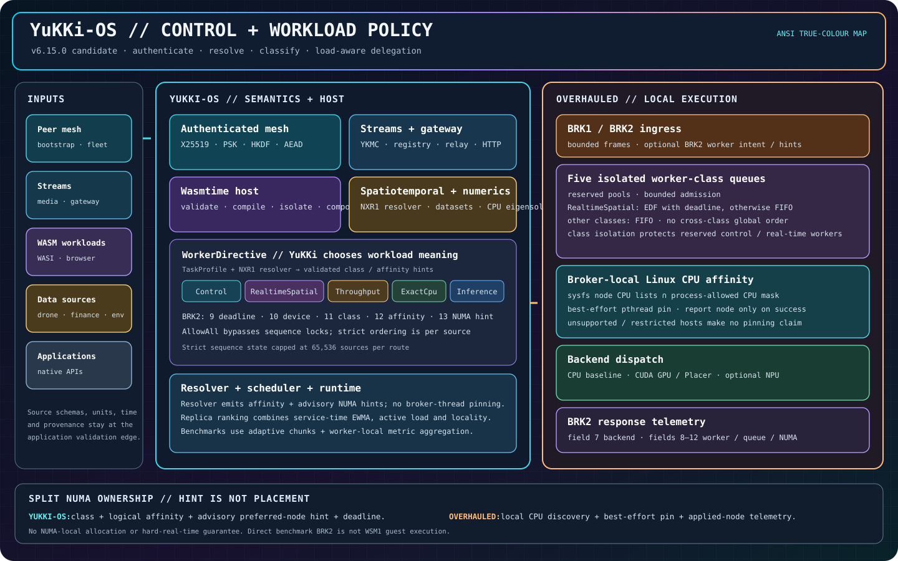

# YuKKi-OS v6.18.0 — Architecture (release candidate)

## System identity and scope

YuKKi-OS is a modular distributed systems platform implemented primarily in Rust. It provides an authenticated control-plane mesh and a collection of runtime, isolation, interoperability, and streaming services for coordinating distributed workloads across native and WebAssembly deployment environments.

Its architectural pillars are:

- **Distributed control plane:** authenticated peer sessions, node registration, fleet coordination, and stream discovery.
- **Concurrent runtime primitives:** bounded MPMC queues and portable NUMA topology discovery.
- **Execution isolation:** Wasmtime-based WebAssembly sandboxing with host-mediated access to selected services.
- **Interoperability:** C FFI components and versioned Rust/C++ broker wire contracts.
- **Data and streaming:** bounded media chunk storage, stream registry, gateway, relay, and geospatial codecs.
- **Hardware integration:** optional accelerator execution through an external broker such as [Overhauled](https://github.com/rakshas-oss/overhauled).

YuKKi-OS does not implement a complete general-purpose kernel or physically pin the Overhauled broker's worker threads. YuKKi-OS owns workload semantics, stable worker-class selection, spatial-affinity keys, deadlines and advisory preferred-NUMA hints. Its topology discovery/resolver contributes hints; Overhauled independently discovers the CPUs allowed to its broker process and applies best-effort Linux worker-thread affinity. NUMA-local memory allocation and cross-node work stealing are not implied. GPU/NPU placement and accelerator execution remain broker-owned.

This document describes the v6.18.0 minor-release candidate. The latest published baseline is v6.17.0 (2026-11-22); the 6.18.0 tag and release assets have not been published.

### Broker discovery and BRK2 locality extension (v6.16.0 published baseline)

YuKKi-OS owns workload policy and the control-plane side of broker endpoint
discovery. Its bounded lease-based `BrokerServiceRegistry` advertises an
optional endpoint and relays validated records through the authenticated
bootstrap/gossip mesh. The bootstrap cache is in-memory and the mechanism is
not a Kademlia DHT. Discovery records are not authorization; the BRK1/BRK2
broker transport remains unauthenticated and must be protected by a trusted
private network or independent mTLS proxy.

The BRK2 locality codec encodes request field 14 intent and response field 13
placement results. This is wire-codec support only: Overhauled remains the
owner of local allocation and execution, and does not yet apply or verify
physical payload-memory placement. An absent result means unknown/not applied.
The codec does not imply locality for WASM linear memory, datasets, accelerator
staging, GPU VRAM or NPU memory.

### Full-colour system map

The ANSI-inspired source SVG is paired with a terminal renderer:
`bash docs/diagrams/print-ansi.sh`. The map shows the five YuKKi-selected
worker classes, the NXR1 spatiotemporal resolver, bounded per-source
sequence policy, and BRK2 fields 9–14 (including the nested locality-placement
intent and response outcome codec). It also captures the
load-aware composition scheduler (service-time EWMA + active-call load +
logical locality) and adaptive, worker-local benchmark aggregation. The
responsibility boundary remains explicit: YuKKi emits workload meaning and
advisory hints; Overhauled owns broker queues, physical CPU placement,
backend dispatch and execution telemetry. It is not a claim that every
library service is exposed through the node CLI or an HTTP endpoint, nor a
claim of hard-real-time behavior or physical NUMA-local memory allocation.

## Authenticated deployment and independent stream trust

The `yukkios::wasm_handoff` module builds signed WASM prepare, publisher
attestation, sequential artifact chunk and activation messages. It uses
pluggable Ed25519 signer and receiver-verifier interfaces; its
`HandoffTransport` boundary requires an authenticated protected channel and
does not silently fall back to the ordinary unauthenticated BRK1/BRK2 socket.
The Rust sender verifies signed receiver decisions and receipts before
reporting acceptance/activation. A concrete TLS adapter and durable replay
store are not included yet.

This executable-artifact trust domain is deliberately separate from streams.
Untrusted NXR1/MED1/YKMC sources can still be ingested and consumed without
being trusted WASM publishers. Their resource protection comes from byte
ceilings, bounded registries/queues, per-peer gateway request buckets,
per-peer/global WebSocket limits, acknowledgement backpressure, relay pull
limits and idle timeouts. See [streaming how-to](USER_HOWTO_STREAMING.md) and
[authenticated handoff](WASM_AUTHENTICATED_HANDOFF.md).

## WebAssembly composition ownership and broker interoperability

YuKKi-OS remains the deployment-policy and program-composition authority.
Its Rust `CompositionRuntime` validates deployment manifests, module
dependency DAGs, typed function bindings, replica policy and release
activation. It maintains its own Wasmtime engine, process-local compiled
module cache, Store/instance graphs and time-weighted replica scheduler.

Overhauled's optional native Wasmtime runtime-composition facility is a
separate broker-side execution path. When that feature is enabled and built
with its pinned Wasmtime C API dependency, Overhauled can compile core-Wasm
module bytes and register modules in its own linker for runtime import
resolution. It does not become the owner of YuKKi manifests, deployment
authorization, dependency policy, release routing or YuKKi replica state.
Likewise, YuKKi does not silently delegate its existing composition runtime
to the broker.

YuKKi-OS now exposes an explicit cross-process artifact-transfer client in
`yukkios::wasm_handoff`. `HandoffSender` builds signed prepare, publisher
attestation, sequential chunk and activation messages, then drives them over
a caller-supplied `HandoffTransport`. The paired Overhauled `HandoffReceiver`
verifies separate sender/publisher trust, stages bounded artifacts and can
promote a complete release through its optional Wasmtime runtime bridge.

This is an explicit API, not automatic deployment of a YuKKi
`CompositionRuntime` release: module caches, compiled modules, Store/instance
graphs, replica pools and routing state are not transferred. The ordinary
BRK1/BRK2 listener is not a handoff endpoint, and no concrete TLS transport
adapter or durable replay/staging service is shipped. The caller must supply
an authenticated protected transport (mTLS 1.3 or equivalent) and bind the
transport peer identity to the signed sender. YuKKi and Overhauled runtimes
retain independent engines, stores, caches, limits and lifecycle boundaries;
successful preparation or activation in one does not prove success in the other.
See [WASM runtime interoperability](WASM_RUNTIME_INTEROP.md).

## Parallel workload resolution and composition scheduling

The v6.16.0 candidate reduces unrelated-work contention without claiming a
lock-free runtime:

- Resolver `AllowAll` traffic bypasses sequence-state locks. Strict sequence
  validation uses a bounded source map and one mutex per source, so distinct
  sources can proceed concurrently while same-source check/enqueue/watermark
  ordering remains serialized.
- Strict source-state tracking is capped at 65,536 source identities per
  route. Reaching the cap returns an explicit error; queue-full does not
  advance the accepted-sequence watermark.
- Composed-program replica ranking incorporates a snapshot of active calls
  alongside the measured service-time EWMA and stable logical locality hint.
  The scheduler uses the snapshot to avoid overloading a busy replica, while
  the Store's non-blocking lock remains the authoritative admission check.
- Native benchmark workers claim batches/solves in adaptive chunks and merge
  worker-local measurement accumulators after completion.

The bounded MPMC queues remain mutex/condition-variable based. These changes
do not add physical NUMA pinning, a new daemon deployment interface, or
zero-stall guarantees. They preserve YKMC, BRK1/BRK2, NXR1 and WSM1 contracts.

## Runtime topology

YuKKi-OS runs as a control-plane mesh with two process roles:

- `bootstrap <bind-address>`: accepts peer registrations and broadcasts fleet updates
- `node <bootstrap-address> <advertised-address>`: registers to bootstrap and receives fleet updates

The CLI also provides an authenticated stream gateway and `streams list` /
`streams tune` clients. When `YUKKI_GATEWAY_TOKEN` is set, a node starts an HTTP/WebSocket gateway sharing its in-process stream registry. Its default bind address is `127.0.0.1:7670`, configurable with `YUKKI_GATEWAY_LISTEN`.

## Broker discovery, NUMA memory locality, and deterministic execution

### Broker discovery control plane

YuKKi-OS is the canonical discovery authority for Overhauled services. The current implementation is a bounded lease registry relayed by the existing authenticated bootstrap/gossip mesh: records are schema-versioned, expire, are capped at 4,096 services, refresh on a 90-second lease, and are forwarded for at most eight hops. This is useful service discovery, but it is not a Kademlia/XOR-routing DHT, has no durable registry, and does not make the C++ broker a direct mesh participant. Keep the BrokerServiceRecord contract stable so a future DHT lookup/routing backend can replace gossip without changing service identity or capability semantics.

Discovery returns candidate endpoints only. YuKKi-OS must apply its own admission policy, and the selected endpoint must still be protected by an independently authenticated transport boundary (for example, an mTLS proxy) because BRK1/BRK2 broker TCP is not authenticated. A discovered record or capability label is never execution authorization or proof that an accelerator is available. See [BROKER_SERVICE_DISCOVERY.md](BROKER_SERVICE_DISCOVERY.md).

### NUMA and memory-locality contract

YuKKi-OS owns workload locality policy and the topology context used to form hints. The current BRK2 directive carries a logical affinity key and an advisory preferred NUMA node; Overhauled independently validates its process cpuset and applies best-effort worker-thread CPU affinity. The response can report the node actually applied. This is CPU-thread placement telemetry, not proof that request buffers, guest linear memory, datasets, or accelerator staging buffers were allocated on that node.

BRK2 v1 now defines the negotiated, versioned codec surface for locality placement. Request field 14 contains bounded nested intent with extension version, scope, mode (`prefer`, `bind`, or `interleave`), conditional NUMA node, and payload-size ceiling. `prefer` is non-critical for old-peer compatibility; `bind` and `interleave` require the critical bit. Response field 13 carries a structured placement result. Rust helpers validate version, scope, mode, node presence, size bounds, duplicate nested fields, unknown critical fields, and critical-flag/mode agreement. An absent response result is unknown/not applied, never success. This remains codec support only: the Overhauled broker-owned payload allocator has not yet applied or verified the policy, and the GPU adapter does not automatically request it. Do not claim NUMA-local placement for request buffers, Wasm linear memory, datasets, accelerator staging, GPU VRAM, or NPU memory. The host-side allocator that owns an allocation must apply the intent and report the actual outcome; unsupported platforms and containers must report explicit fallback/rejection rather than silently claim locality. Keep raw CPU masks and machine-specific topology private to each host; do not put them in service-discovery records.

### Deterministic execution contract

The existing RealtimeSpatial class isolates capacity and orders deadline-carrying work earliest-deadline-first within each leaf queue. This is a cooperative scheduling policy: it does not preempt a running task, bound worst-case execution time, control interrupt latency, or guarantee deadline completion. Wasmtime fuel is an instruction budget, not a wall-clock deadline.

Treat hard-real-time operation as a separately qualified deployment profile, not a flag or a property inferred from EDF. Qualification would require a supported real-time kernel and scheduler configuration, isolated CPUs and interrupt routing, locked/preallocated memory, bounded allocation and syscall paths, priority-inversion controls, explicit admission/WCET budgets, and worst-case latency/jitter tests under adversarial load. Until those controls and measurements exist for a named hardware/software target, describe the system as deadline-aware or soft-real-time only.

## Control-plane transport

- Transport: TCP
- Framing: 4-byte big-endian length prefix
- Max plaintext frame: 64 KiB
- Session setup:
  1. X25519 ephemeral key exchange
  2. HKDF-SHA256 using shared secret + `YUKKI_PSK_HEX`
  3. ChaCha20-Poly1305 directional ciphers (`client->server`, `server->client`)
  4. Auth confirmation frame exchange
- Timeouts:
  - handshake timeout: 10s
  - I/O timeout: 30s
- Bootstrap inbound concurrency cap: 128 connections

## Peer registry behavior

- Peer registration payload is JSON:
  - `Register(PeerInfo { uuid, addr })`
- Fleet update payload is JSON:
  - `NodeFleet(Vec<PeerInfo>)`
- Peer state is in-memory only.

Stream announcements and SHA-256 descriptor digests are additional encrypted
`SovereignCommand` messages on the same authenticated TCP session. Bootstrap
relays each bounded, deduplicated announcement to the other connected nodes.
Nodes exchange a compact digest every 30 seconds while idle and announce full
descriptors for mismatches. Announcements expire after 120 seconds, have at
most eight hops, are limited to 16 KiB, and are deduplicated using a 4096-entry
cache. Fan-out is bounded by the existing 128-connection bootstrap limit.

## C FFI frame engine

- Header: `src/ffi/laminar_api.h`
- C implementation: `src/ffi/chaos_weave.c`
- Rust ABI struct: `SpatiotemporalFrame` (`88` bytes, packed/aligned for C interop)

C exports include:

- Lorenz/chaos functions (`chaos_engine_init`, `chaos_engine_reseed`, `generate_lorenz_step`, `weave_spatiotemporal_frame`)
- OOB helper functions (`oob_fnv1a_rolling_hash`, `oob_integrity_update`, `oob_sync_check`, `oob_quarantine_node`, `oob_is_quarantined`)

These FFI APIs are currently library-side primitives; the node CLI path does not expose direct runtime commands for OOB quarantine management.

## Broker integration boundary

`src/broker_client.rs` is intentionally isolated from peer-mesh transport:

- One TCP connection per broker submission
- Length-prefixed JSON request/response
- Independent request and connect timeout controls
- Request/response shape validation before/after I/O

The generic broker client is a separate integration from the Overhauled adapter. Its raw TCP transport is not authenticated by the peer-mesh session. `YUKKI_BROKER_TRANSPORT_SECURITY=authenticated-proxy` records the expected deployment boundary; it does not enable TLS or authenticate the socket.

## Worker-class directives and broker placement

YuKKi-OS owns workload semantics and policy selection. The public
`WorkerClass` and `WorkerDirective` APIs map existing `TaskProfile` values
and resolved spatial context into Control, RealtimeSpatial, Throughput,
ExactCpu or Inference directives. Resolved NXR1 source/destination routes
produce a stable logical affinity key; the resolver's NUMA node remains an
advisory hint.

When a directive is submitted through the Overhauled adapter, the client
requires BRK2 and encodes optional request fields 11 (worker class), 12
(logical spatial affinity U64) and 13 (preferred NUMA node U32). A relative
`TaskProfile.deadline_ms` is converted with checked arithmetic to an absolute
Unix-nanosecond deadline using the caller's submission timestamp.

Lifecycle operations are classified as Control. Generic BRK2 WSM1 task
submissions default to Throughput; inference work must explicitly use
Inference. Existing BRK1 and raw WSM1 paths remain compatible and do not
transmit directives. The inner WSM1 payload and NXR1 frame semantics are
unchanged.

Overhauled owns local class queues, deadline ordering, process-wide admission
budgets, Linux worker-thread CPU/NUMA affinity, backend selection and execution.
A preferred NUMA node or logical affinity key does not prove physical
placement; the broker reports an applied NUMA node only after affinity
succeeds. See [Worker class policy](WORKER_CLASS_POLICY.md) and
[Overhauled worker fabric](https://github.com/rakshas-oss/overhauled/blob/main/docs/YUKKI_WORKER_FABRIC.md).

## Geospatial and live media codecs

`src/arcgis.rs` represents avenue/road-network line geometry as GeoJSON
LineString Features with WGS84 longitude/latitude coordinates and optional
`route_id`/`avenue_name` metadata. It does not reinterpret the legacy `NXR1`
fluid/numeric fields and does not claim compatibility with proprietary
ArcGIS feature-service formats. GeoJSON Features can cross the existing
`BrokerTask` JSON boundary under `geospatial.arcgis.avenue.v1`.

`src/nxr1.rs` provides a dependency-free NXR1 binary codec for geospatial frames,
matching the `rakshas-oss/overhauled` wire contract (magic `0x4E585231`, version `1`,
big-endian fixed geospatial/velocity/fluidity/drag/divergence fields, `u32` BE
length-prefixed opaque payload). NXR1 frames can be wrapped in the existing
`BrokerTask` JSON envelope under kind `geospatial.frame.v1`.

`src/media_codec.rs` frames opaque codec payloads in YKMC v1 chunks and offers
the synchronized, in-process `LiveMediaStreams` collection. Audio/video
codec bitstreams are pass-through only; no transcoding occurs. Stream
appenders must supply contiguous sequence numbers beginning at zero. The
default store limits are 64 streams, 64 chunks per stream, 256 chunks total,
256 KiB per chunk and 64 MiB retained payload. Default ingestion token buckets
allow 1,024 chunks/s globally (burst 256) and 8 MiB/s globally (burst 4 MiB),
plus 256 chunks/s per stream (burst 64) and 2 MiB/s per stream (burst 1 MiB).
Stream creation has its own 16/s (burst 32) budget. Hard configuration
ceilings are 256 streams, 4,096 chunks per stream, 16,384 total chunks,
256 KiB per chunk, 64 MiB retained bytes, 4,096 chunks/s and 64 MiB/s.
Exhausted capacity/rate budgets return bounded errors/backpressure instead
of allowing unbounded retention. Consumers reclaim storage with
`acknowledge_through` or `remove_stream`. A chunk can be wrapped in the
existing BrokerTask JSON envelope, but its JSON byte-array expansion remains
subject to the broker client's configured frame-size limit.

`src/stream_registry.rs` derives local stream descriptors from store snapshots
and merges remote descriptors. Subscriptions have independent sequence cursors
and aggregate acknowledgements; per-stream and per-node subscriber ceilings
avoid per-consumer unbounded buffering. `src/stream_gateway.rs` exposes
authenticated HTTP list/describe/range endpoints and an ack-driven WebSocket
binary stream. The gateway caps accepted TCP connections at 128 and HTTP
request handling at 30 seconds; WebSockets use 60-second idle timeouts with
20-second pings. It does not provide TLS.

The mesh distributes discovery metadata. `src/stream_relay.rs` adds an opt-in
`StreamRelay` that mirrors a remotely discovered stream into the local store via
a pluggable `ChunkSource`. `OriginChunkClient` implements this interface for
the origin gateway's HTTP descriptor and range endpoints, using plain HTTP and
an optional bearer token. All local subscribers share one rate-limited upstream
pull per stream, and the mirror is an ordinary local stream, so downstream
nodes can relay from it to form fan-out trees. `stream_gateway::serve_with_relay`
uses a configured relay for remote WebSocket tune-in; plain `serve` still
returns `501` for remote streams. The current descriptors do not include codec
metadata, so `OriginChunkClient` reports the codec as `unknown`; applications
must account for this when relaying media.
The standalone `gateway` command
owns a separate in-memory store, while the optional node gateway shares that
node's store and registry.

WASM stream selection remains host mediated: `wasm_ingest` validates guest
memory ranges before copying one bounded encoded chunk through
`env::yukki_select_stream`. No raw pointers or direct store handles are exposed.
Applications must still protect broker TCP links with an authenticated proxy
or equivalent deployment boundary.

## Browser spatial and motion runtime

The separate `browser-wasm/` application builds a dependency-free Rust
module for `wasm32-unknown-unknown`. It is not a browser build of the native
node, the Wasmtime guest runtime, or a network service.

- `browser-wasm/src/lib.rs` validates exact YKMC v1 media-chunk framing:
  magic/version, audio/video type, flags, UTF-8 metadata, frame lengths and
  configured size bounds. Media payloads remain opaque; no codec decoding or
  transcoding occurs.
- `browser-wasm/src/mmo.rs` provides WGS84/ECEF and WGS84/ENU transforms,
  ENU-to-ECEF conversion, cubic Hermite interpolation, a fixed 512-entity
  spatial store, inclusive WGS84 bounding-box queries, and
  freshness/distance-constrained nearest-observation resolution.
- The browser module also provides an iterative arc–secant–tangent path
  simplifier with fixed storage for 512 points. It preserves endpoints and
  forces splits at sharp turns. It is intended for ordered trajectories and
  non-safety-critical display or summarization, not flight guidance or
  topology-preserving polygon generalization.
- `browser-wasm/app.js` owns browser HTTP, credentials, forms and rendering.
  The WASM module does not open sockets or access browser APIs. Sample spatial
  entities remain in browser WASM memory and are not automatically uploaded to
  the gateway or Overhauled.

The browser spatial store retains an optional `radius_m` value, but the
current nearest resolver does not use it as a match constraint. It compares
candidate ECEF distance directly against the supplied maximum distance. The
bounding-box and nearest-observation operations are bounded linear scans, not
an indexed spatial engine.

The browser client uses authenticated HTTP GET range reads for gateway
streams. It does not put bearer tokens in URLs or use the browser WebSocket
API, because that API cannot set the custom Authorization header required by
the current gateway WebSocket endpoint. See [BROWSER_WASM.md](BROWSER_WASM.md),
[MMO_BROWSER_WASM.md](MMO_BROWSER_WASM.md), and
[USER_HOWTO_MMO.md](USER_HOWTO_MMO.md).

## Native multivariate datasets and benchmark policy

The native dataset runner is implemented in `src/benchmark_dataset.rs` and
exposed by the `yukki_dataset_bench` binary. Its version-1 benchmark manifest
selects JSONL sources, sequence/timestamp fields, optional geographic fields,
numeric feature mappings, and benchmark profiles.

Each profile drives actual candidate measurements: warm-up records, a
deterministic sample, batch sizes, worker counts, objective, optional P95
latency ceiling, and optional geospatial simplification settings. The report
contains candidate measurements and a recommended batch/worker configuration.
The selected product is used to derive a bounded queue policy and can be used
by `SpatiotemporalPayloadResolver::register_benchmarked_destination` to
register an actual bounded component queue.

The native loader is bounded (including manifest, dataset, record, row-count,
feature, batch and worker ceilings) and rejects malformed or non-finite
records and invalid geographic coordinates. The native workload performs
NXR1 encode/decode round trips while retaining each complete JSONL source row
as opaque payload. The first nine declared numeric features map to the generic
NXR1 fields; geographic coordinates are handled separately by the geospatial
profile.

There are two distinct manifest contracts:

- `schemas/multivariate-datasource-manifest.schema.json` describes
  application-level heterogeneous sources, variables, units, temporal/spatial
  semantics, provenance, quality and access-policy references.
- `examples/benchmark-datasets/manifest.json` is the concrete version-1
  input consumed by `yukki_dataset_bench` and
  `yukki_eigensolver_bench`. It names JSONL files and benchmark field
  mappings.

The general data-source schema is not directly consumed by the native
benchmark runner. An application adapter or conversion step must map a
source-catalogue entry into the benchmark manifest and preserve source
provenance, units, quality flags and original attributes.

## Native symmetric eigensolver

YuKKi-OS owns a CPU cyclic-Jacobi implementation in
`src/symmetric_eigen.rs`. It accepts finite real-symmetric row-major
matrices with dimensions 1..=64 and returns ascending eigenvalues, column
eigenvectors, relative residual, orthogonality error and sweep count. It
rejects invalid dimensions, lengths, non-finite values, material asymmetry,
invalid options, non-convergence and numerical overflow.

The separate `yukki_eigensolver_bench` binary reads
`eigensolver_profiles` from the native benchmark manifest, constructs
bounded correlation-matrix workloads from the declared feature fields, and
reports solver throughput, latency and numerical diagnostics. This is a
small/medium covariance/correlation analysis primitive, not a general
complex or non-symmetric eigensolver. It does not claim GPU/NPU acceleration.
The real `arcsecant` helper is a domain-checked mapping, not an eigensolver.

See [BENCHMARK_DRIVEN_DATASETS.md](BENCHMARK_DRIVEN_DATASETS.md),
[BENCHMARKING.md](BENCHMARKING.md), and [API.md](API.md) for operational
commands, manifest details, API shape and benchmark scope.

## WebAssembly compilation, guest execution, lifecycle, and accelerator boundary

The native Rust build enables Wasmtime's `cranelift` compiler feature. Wasmtime compiles WebAssembly modules on the native host; guests do not receive native pointers or execute outside the sandbox. The repository currently has three distinct native-host WebAssembly paths: the basic sandbox API, the restricted inference guest-worker ABI, and the multi-module CompositionRuntime. They should not be confused with the separate `browser-wasm/` application described above.

### Native sandbox API

`src/wasm_sandbox.rs` exposes `RustasmSandbox::execute` for a small core-Wasm ABI:

- Wasmtime compiles the supplied bytes with `Module::new`, instantiates the module, and calls the exported `main() -> i32` function.
- The instance is created with an empty import list, so this entry point does not provide WASI, filesystem, network, or custom host imports.
- Per-store linear memory is limited to 16 MiB; the Wasmtime stack limit is 512 KiB.
- Fuel defaults to 10,000,000 and can be changed with `YUKKI_WASM_MAX_FUEL` (positive integer only).

This API is a bounded module runner, not an integrated LLM runtime.

### Restricted inference guest-worker API

`src/wasm_ingest.rs` provides the separate worker ABI used by the `guest-worker/` crate:

- Module byte length is capped at 4 MiB; an input tensor is capped at 16 MiB.
- The store's linear memory is capped at 64 MiB, fuel defaults to 10,000,000, the Wasm stack is capped at 512 KiB, and an epoch watchdog bounds execution to 10 seconds.
- Only two host imports are accepted: `env.wasmtime_yield_xpu(i32, i32) -> i32` and `env.yukki_select_stream(i32, i32, i32, i32) -> i32`.
- The module must export `memory` and `execute_inference_pipeline(i32, i32, i32) -> i32`.
- The host validates guest-memory ranges before copying the bounded tensor or a YKMC chunk. The guest receives no native pointer or direct media-store handle.
- `run_guest_with_streams` creates an Engine, compiles the module, links the approved imports, and instantiates a fresh guest instance for each call. The XPU operation is an injected host callback; it is not an automatic connection to a specific physical accelerator.

The shipped `guest-worker` is a small `no_std` worker: it validates its input/channel, uses an atomic channel lock, computes a non-cryptographic FNV-style integrity/telemetry hash, and yields to the host. It does not include `llama.cpp`, model weights, tokenization, or a language-model inference implementation. Compiling such a runtime for Wasm is a separate integration requiring a compatible ABI, model/weight delivery, and a host compute delegate.

`wasm_ingest::handle_deploy` is a pure request handler, not an HTTP listener. It validates the `application/wasm` body and channel header, then smoke-runs the module with a 16-byte zero tensor. It does not persist the artifact or register it for subsequent inference. A front end must authenticate the caller before invoking it and must own artifact storage and any persistent deployment API.

### Version lifecycle and the meaning of hot-swap

`ModuleLifecycleManager::prepare_version` synchronously creates a Wasmtime Engine and compiles/validates the candidate with `Module::new`. The compiled `Module` is then dropped; the manager stores the original Wasm bytes in the version handle. It does not maintain a compiled-module cache.

`ModuleLifecycleManager::hotswap` coordinates a version transition:

1. Optionally asks the Overhauled lifecycle endpoint to prepare the module ID/version and obtains its lease/placement response.
2. Runs `StateHandoffHook` only when both old and new versions provide hooks. The hook transfers application-defined serialized state, not Wasm linear memory, native pointers, GPU VRAM, CUDA streams, or model weights.
3. Switches the YuKKi-OS active-version routing map under a write lock.
4. Quiesces the previous version, waits for in-flight work to drain, then requests broker release and releases the old local version resources.

Preparation or state-handoff failures occur before the local routing switch and leave the old version active. A drain timeout occurs after the switch: the new version may already be active, while old resources remain retained rather than being released during in-flight work. The manager is a library API; `yukki_core_node` does not expose a module-deployment or hot-swap CLI. The application must connect `execute_task` to the appropriate guest execution function.

This statement is scoped to `ModuleLifecycleManager`: that version-replacement API performs optional structured-state handoff but does not link multiple Wasm modules, merge policy functions, dynamically resolve arbitrary guest imports, migrate live guest memory, or retain compiled modules across replacements. Candidate compilation is synchronous in `prepare_version`, not a background compilation pipeline. **Multi-module composition is provided by the separate `CompositionRuntime` below**; it is not performed by `ModuleLifecycleManager` or by Overhauled's WSM1 lifecycle manager.

### Accelerator boundary

`RustasmSandbox::submit_gpu_task` is a separate host-mediated broker adapter. It accepts payloads up to 64 KiB, uses task/module/version identifiers, and sends work to Overhauled only when the application configures the adapter. The adapter is disabled by default (`YUKKI_GPU_ADAPTER_ENABLED=false`). The guest is not given CUDA pointers or direct VRAM access.

Overhauled owns backend selection, GPU placement, broker queueing and its optional NPU executor. The CUDA-aware broker path, separate optional `gpu_runtime_server` TensorRT target, and opt-in Linux Ethos-U85 DRM executor are distinct execution configurations. The Ethos-U85 path requires a compatible Vela-generated `YU85BND1` bundle; it is not a generic LLM executor. The host must explicitly wire a guest's XPU callback or application task to the selected broker path; configuring the adapter alone does not make every guest operation accelerator-backed.

The Wasm linear-memory and host-buffer ceilings above are not a VRAM reservation. Device availability, placement and in-flight limits are managed by Overhauled; the repositories do not currently expose one cross-tier VRAM-headroom guarantee for arbitrary guest models.

See [SYSADMIN_HOWTO.md](SYSADMIN_HOWTO.md), [guest-worker/README.md](../guest-worker/README.md), and [Overhauled WASM interoperability](https://github.com/rakshas-oss/overhauled/blob/main/docs/WASM_INTEROP.md).

### Composed executable programs and time-weighted replica routing

`src/wasm_composition.rs` provides a native-host composition runtime for one
or several live policy programs. A versioned JSON manifest declares each
program's module graph, import-namespace bindings and entrypoint. YuKKi-OS
compiles core-Wasm modules through one Wasmtime Engine, checks exact imported
function signatures, orders the module DAG, and instantiates a program's
module graph into one or more isolated Stores.

Composition v1 accepts cross-module function imports only. Imported memory,
globals, tables, tags, WASI imports, unbound host namespaces and cyclic graphs
are rejected. The public entrypoint accepts zero to eight i32 arguments and
returns one i32; internal imported functions may use other core-Wasm function
signatures.

The same compiled module can be reused by multiple programs and replicas.
Compiled modules are cached in-process by SHA-256 content digest (256 entries
by default). Every replica has its own Store and instances, so guest memory,
globals and tables are not shared. The default is one stateful replica per
program. Multi-replica execution must be explicitly declared with
`stateless: true`, because requests can run against separate copies of guest
state. The default resource ceiling is eight replicas per program and 32
replicas per deployment. Each Store has a 4 MiB per-memory limit, up to 16
memories/tables/instances, a 65,536-element per-table limit, and a
10,000,000-fuel budget reset for each call.

`src/temporal_spatial_scheduler.rs` ranks a program's replicas using an
exponentially weighted service-time estimate (7/8 previous estimate and
1/8 latest sample) plus an optional stable spatial/affinity key. The key is
mapped to a preferred logical slot with a fixed SplitMix64 finalizer. Each
non-preferred replica receives a 25% penalty relative to its current service-
time estimate; measured service cost can therefore beat locality when a
replica is materially faster. A rotating cursor supplies deterministic
round-robin tie breaking. This is logical workload affinity, not physical
NUMA pinning or geographic-coordinate scheduling. It complements, but does
not replace, `SpatiotemporalPayloadResolver`, which handles NXR1 decoding,
destination queues and per-source sequence policy.

The scheduler's current implementation is more specific:

- The initial service-time estimate is 1 ms. Each completion updates it as
  7/8 of the previous estimate plus 1/8 of the latest measured duration.
- A 64-bit logical key is mapped to a preferred replica with a stable
  SplitMix64 finalizer followed by modulo the configured replica count.
- A non-preferred replica receives a locality penalty equal to 25% of its
  current service-time estimate. A sufficiently faster replica can therefore
  outrank the preferred logical shard.
- Equal predicted scores are rotated with an atomic cursor rather than always
  beginning at replica zero.
- Completion samples include failed invocations because they consumed
  service time. Scheduler snapshots expose each replica's EWMA and
  completed-call count; the composition API additionally exposes active calls.

Here, "spatial" means an application-defined logical affinity key such as a
tenant, entity, tile, sensor or partition. It is not a latitude/longitude
lookup, geographic route planner, CPU-thread pinning mechanism or physical
NUMA placement operation.

The scheduler returns a ranked list; the composition caller attempts
non-blocking Store admission in that order and skips a replica whose Store is
already locked. If all replicas are occupied, the runtime returns
`CompositionError::ProgramSaturated`. This reduces head-of-line blocking while
spare replicas exist; it does not guarantee zero stalls when all replicas are
busy. Fuel is an instruction budget, not a wall-clock deadline. Per-replica
EWMA service time, completed-call count and active-call count are exposed for
operational feedback.

A release containing several programs becomes active with one
`ProgramSet` routing-map replacement. Calls admitted before the switch keep
the old release alive until completion; new calls use the new release.
Preparation compiles, validates, links and instantiates all programs and
replicas before activation, so a preparation error leaves live routing
unchanged.

This is a host-side Wasm module graph, not a merged native binary or
persistent AOT artifact. The compiled cache is process-local. The API has no
built-in deployment CLI or HTTP endpoint; the embedding application owns
artifact delivery and authorization. It is designed for policy/orchestration
modules, not LLM weights or a general WASI runtime.

See [WASM_PROGRAM_COMPOSITION.md](WASM_PROGRAM_COMPOSITION.md) for the
manifest, replica configuration, scheduler behavior, API examples and
resource boundaries.

## Known implementation limitations

- Shared PSK trust model; no per-peer identity or rotation protocol
- No built-in TLS/mTLS transport wrapping for peer or broker sockets
- No persistent runtime state store
- No HTTP health endpoint; health is log- and process-state based
- Remote stream relay requires application wiring; the CLI does not configure
  an origin client or relay automatically

## NUMA, MPMC, and broker worker directives

See [NUMA_MPMC_RUNTIME.md](NUMA_MPMC_RUNTIME.md) for YuKKi-OS topology discovery
and bounded MPMC semantics. YuKKi-OS does not pin Overhauled worker threads:
the new [worker-class policy](WORKER_CLASS_POLICY.md) can forward a resolver
NUMA hint and logical affinity key through optional BRK2 fields. Overhauled
discovers its own process-allowed CPU topology and attempts local Linux worker
affinity. YuKKi's time-weighted Wasm replica scheduler remains separate from
the broker's per-class FIFO queues.

## YuKKi-directed worker classes

`src/worker_policy.rs` owns the stable workload classes, validation of logical spatial affinity/deadlines, and conversion of resolved spatial payloads into optional broker hints. `src/gpu_adapter.rs` transmits these only in BRK2 and returns optional queue/service/NUMA telemetry alongside the unchanged WSM1 response. Lifecycle operations use Control; generic BRK2 WSM1 task submissions default to Throughput. Callers explicitly classify model inference with the Inference directive. BRK1 and raw WSM1 behavior remains unchanged. See [WORKER_CLASS_POLICY.md](WORKER_CLASS_POLICY.md) for the wire fields and API examples.
